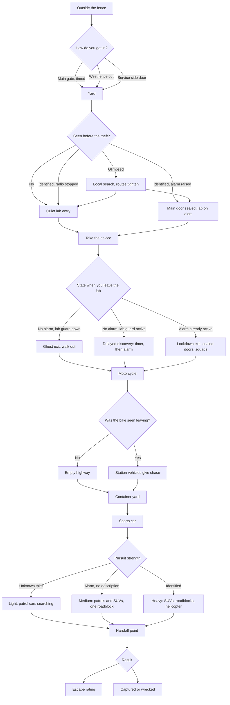

# PROTOCOL — Game Design Document

Status: **draft, waiting for Gate 1 approval.**
Builds on `docs/00-project-brief.md`. All numbers are starting values for tuning, not final.

## 1. Concept

You are a professional thief hired for one job: take an experimental energy device out of a desert research facility and get away with it.

PROTOCOL is one continuous night. It begins on foot outside the fence and ends at speed on a desert highway. There is one mission, but no fixed way through it. How quietly you work inside the building decides who is chasing you an hour later.

**Pillars**

1. **Your choices follow you.** What the guards saw, heard and reported changes the facility, the escape, and the pursuit.
2. **A thief, not a soldier.** No gun. You win by watching, timing and nerve. Fighting is possible and always costly.
3. **Getting caught out is not failing.** A blown stealth attempt opens a harder, louder version of the mission. Only capture or a wrecked vehicle ends a run.
4. **Looks like a film, plays like a game.** Cinematic moments are short and skippable. Control and readability come first.

**Length:** about 35–50 minutes for a first full run. Built to be replayed for a different outcome.

## 2. Story

**Setting.** A remote desert, dusk turning to night. Halden Research Station is a private laboratory guarded like a military site.

**The protagonist.** Known only by the call sign **Wren**. Masked, calm, rarely speaks. Works alone on site.

**The handler.** **Sable**, a voice in Wren's earpiece. Gives objectives, reacts to what happens, and is the player's source of hints. Sable is also the client's only point of contact, which matters at the end.

**The device.** Project name **LATTICE**: a hand-sized energy core in a metal cage, glowing blue, with slowly turning internal rings. It hums. When it is removed from its cradle, lights nearby flicker.

**The night, in order**

1. **Arrival.** Wren studies the station from outside the fence. Sable gives the brief: the device is in the lab at the back of the main building.
2. **Infiltration.** Through the gate, a cut in the west fence, or the service side. Past the yard and into the building.
3. **The theft.** Wren lifts LATTICE from its cradle.
4. **Getting out.** On foot back through, or around, a station that may or may not know what happened.
5. **Motorcycle.** A bike is hidden beyond the west fence. Wren rides out along the desert highway.
6. **Container yard.** The bike is known or nearly out of fuel. Sable directs Wren to a freight yard where a client's sports car is waiting inside a container.
7. **The car and the pursuit.** Police pick up the trail. How hard they come depends on what the station reported.
8. **The handoff point.** A marked stretch of highway where the pursuit must be broken before Wren can turn off into the dark.

**Ending note.** If Wren escapes cleanly, Sable's last line hints that the client now has what they wanted and Wren knows too much. This sets up a later mission without committing to one.

## 3. Mission flow and branching

Stages are fixed. What happens inside each stage is not.



**The four approaches from the brief, as they play here**

| Approach | What it looks like | What it costs later |
|---|---|---|
| A. Stealth | Never identified, lab guard dealt with or avoided | Nothing. Light pursuit or none. |
| B. Combat first | Takedowns in the yard, a body gets found, alarm before the theft | Main door seals, lab is alert, lockdown exit, heavy pursuit |
| C. Mixed | Glimpsed, hides, continues; or identified and stops the radio call in time | Local search inside; pursuit depends on whether an alarm ever went out |
| D. Steal first, found later | Clean theft, then the empty cradle is noticed | Alarm mid-escape with no description: medium pursuit |

These are not scripted paths. They are what the rule system in section 6 produces from the order events happen in.

## 4. Guard perception

### States

`Unaware → Suspicious → Investigating → Identified → Alerted`, plus `Searching` and `Lost Target`.

| State | Guard behaviour | How it is entered |
|---|---|---|
| Unaware | Patrols or stands post | Default; awareness below 0.25 |
| Suspicious | Stops, turns toward the cue, says a line | Awareness 0.25–0.6 |
| Investigating | Walks to the last cue position, looks around | Awareness 0.6–1.0, or a noise, or a radio report |
| Identified | Has clearly seen Wren. Starts a radio call, then gives chase | Awareness reaches 1.0 |
| Alerted | Facility alarm is active. Moves fast, weapon ready | Alarm raised |
| Searching | Sweeps an area in a pattern, checks hiding spots | Lost sight after Identified, or arrived at a reported position and found nothing |
| Lost Target | Gives up the sweep, returns to a tighter patrol, stays wary | Search timer runs out |

### Awareness meter

Each guard has a meter from 0 to 1 for Wren. When Wren is inside the vision cone with a clear line of sight:

```
gain per second = 1.5 × distance × light × movement × angle
```

| Factor | Values |
|---|---|
| Distance | 1.0 at point blank, falling to 0 at 26 m |
| Light | 1.0 lit, 0.4 in shadow |
| Movement | still and crouched 0.3 · sneaking 0.5 · standing still 0.7 · walking 1.0 · sprinting 1.7 |
| Angle | 1.0 in the central 60°, 0.5 out to 120° |

- Within 3.5 m, gain is at least 2.5 per second: you cannot stand next to a guard who is looking at you.
- Out of sight, the meter falls 0.18 per second.
- Rough feel: 10 m away, lit, walking, in front of the guard: identified in about 1.1 seconds. Same distance in shadow and sneaking: about 5.5 seconds.

### Hearing

| Sound | Radius | Effect |
|---|---|---|
| Sneaking | 2 m | None unless very close |
| Walking | 6 m | Suspicious |
| Sprinting | 11 m | Investigating |
| Takedown | 8 m | Investigating |
| Thrown object | 12 m from where it lands | Investigating at that spot (a distraction) |
| Guard's gunshot | 60 m | All in range go to Investigating toward the shot |

Walls halve the radius.

### Cameras

Fixed and sweeping. A camera has the same meter as a guard but cannot hear or move. A full meter sends an image to the control room: if a guard is on station there, he raises the alarm after 3 seconds. If the control room guard is down, cameras record but nobody is watching, and `cameraRecordedPlayer` is still set for the pursuit stage.

### What guards know

Guards are not omniscient. Each one holds only facts he has gained by:

- seeing or hearing it himself;
- a **radio report**, which takes 2.5 seconds to send. If the guard is taken down during those seconds the report is never made;
- the **facility alarm**, which tells everyone that there is an intruder and the last reported position, nothing more.

A guard who has not been told Wren's position goes to the last reported one, not to where Wren actually is.

### Bodies

A downed guard stays down for the mission. If another guard sees him, that guard investigates and radios it in. Bodies can be dragged into shadow or behind cover to prevent this.

## 5. Security levels

Facility-wide. Driven only by events.

| Level | Name | Raised by | What changes | Falls back when |
|---|---|---|---|---|
| 0 | Normal | — | Standard patrols | — |
| 1 | Suspicion | Any guard Suspicious or Investigating | That guard leaves his route | Guard returns to patrol |
| 2 | Local search | A guard Identified Wren, or a body was found, before any radio call lands | Nearby guards converge and sweep one zone | 45 s with no new cue |
| 3 | Facility alert | A radio report completes, a camera alert is confirmed, or the empty cradle is seen | Siren and red lighting. Main door seals. Lab guard holds position. All guards Alerted. | Does not fall during the facility stage |
| 4 | Full lockdown | Level 3 plus a second confirmed sighting, or the device is taken during level 3 | Side doors need a keycard or a forced entry. A response squad of three enters from the gate. The motorcycle route is watched. | Does not fall |
| 5 | External pursuit | Wren leaves the perimeter at level 3 or above | Police are informed. Sets pursuit strength for the vehicle stages. | Falls in the car stage as pursuers are lost |

Level 3 and above persist because the station now knows it has been breached. Levels 1 and 2 are recoverable, which is what makes hiding worth it.

## 6. Mission state and consequences

### Tracked state

| Variable | Meaning |
|---|---|
| `securityLevel` | 0–5, section 5 |
| `deviceStolen` | LATTICE has left its cradle |
| `alarmTriggered`, `alarmBeforeTheft` | Whether, and when relative to the theft |
| `alarmCause` | identified / body found / camera / empty cradle |
| `identified` | Any guard reached a full meter |
| `descriptionReported` | An identifying report or camera image actually reached the control room |
| `witnessCount` | Guards who saw Wren clearly and are still conscious |
| `takedowns`, `bodiesFound` | Combat record |
| `cameraRecordedPlayer` | A camera captured Wren |
| `lastKnownPosition` | Where the station thinks Wren is |
| `escapeRoute` | gate / west fence / service side, and which are blocked |
| `bikeSeen`, `carIdentified` | Whether each vehicle was seen leaving |
| `pursuitStrength` | none / light / medium / heavy |

### Consequences

| What happened | What it causes |
|---|---|
| Never seen | Level stays 0. Walk-out exit. No pursuit until the car stage, then light. |
| Glimpsed, not identified | Level 1–2 locally. One zone gets tighter for a while. |
| Identified, radio call stopped by takedown | Level 2, no alarm. One more body to hide. |
| Identified, call completed | Level 3. Main door seals. `descriptionReported` set. |
| Alarm before the theft | Lab guard holds the device room. East side door is the way in. |
| Theft with no alarm, lab guard down | Nobody discovers it during the stage. |
| Theft with no alarm, lab guard active | 35 s until he sees the empty cradle, then level 3 with no description. |
| Theft during level 3 | Level 4. Response squad. |
| Left the perimeter at level 3+ | Level 5. `pursuitStrength` at least medium. |
| `descriptionReported` and `bikeSeen` | `pursuitStrength` heavy. Helicopter in the car stage. |
| Pursuers lost on the highway | Pursuit drops one step for 20 s: a window to reach the handoff. |

### Pursuit strength rule

- **none**: no alarm by the time Wren reaches the yard.
- **light**: alarm, no description, bike not seen.
- **medium**: alarm and either a description or the bike seen.
- **heavy**: description and bike seen, or level 4 was reached.

All of this is data: a list of rules of the form *when event, if state, then effects* (see `docs/tech-notes.md` §2). New branches are new rules, not new code.

## 7. Combat

**Decision (owner, 2026-11-13): non-lethal melee only. Wren carries no firearm. Nobody dies.**

| Action | When | Result |
|---|---|---|
| **Silent takedown** | Behind or beside a guard who is not Identified, within 1.9 m | Guard unconscious. Quiet (8 m). About 2 s, Wren is exposed while it plays. |
| **Struggle** | Any guard within 1.5 m who is facing Wren | Short timed-input exchange, 2–3 beats. Win: guard down, loud (15 m). Lose: Wren takes a hit and is shoved back. |
| **Drag body** | Next to a downed guard | Slow movement, cannot sprint. Hides the body. |
| **Throw object** | Holding a small object picked up in the world | Noise at the landing point. Distraction only, no damage. |
| **Break away** | Grabbed or cornered | Shove and sprint. Costs stamina. |

**Guards are armed.** Once Identified at range they order Wren to stop, then fire. Wren has three hits of health, restored at checkpoints. Being shot at is a strong push to break line of sight, not a fight to win.

**Why no gun.** It keeps the game about stealth, keeps animation and system scope small enough to polish, and fits the character. A non-lethal gadget can be added later without changing this design.

**Two guards at once** cannot be beaten in a struggle. The answer is to separate them or leave.

## 8. Vehicle gameplay

Handling aims for responsive and exciting, not simulation.

### Motorcycle (stage 5)

- Fast, narrow, fragile. Leans into turns; can thread between obstacles a car cannot.
- Controls: throttle, brake, steer, look back.
- Hazards: sand drifts on the road (loss of grip), rocks, a closed barrier, and at pursuit medium or above, station pickup trucks trying to box Wren in.
- A hard crash throws Wren off: one health lost, bike remounted. Three crashes ends the run.
- Length: about 3–4 minutes.

### Container yard (stage 6)

- On foot again, briefly. A small stealth space: two yard workers and one security guard, cameras on the cranes. Uses the same perception rules.
- Find the marked container, open it, take the car. If pursuit is medium or heavy, a timer runs: police arrive at the yard gate.

### Sports car (stages 7–8)

- Heavy grip, strong acceleration, handbrake for tight turns. Collisions slow the car and add damage; damage reduces top speed, then steering.
- Controls: throttle, brake, steer, handbrake, look back.

### Police

| Unit | Appears at | Behaviour |
|---|---|---|
| Patrol car | light and up | Follows, tries to pull alongside and nudge |
| SUV | medium and up | Rams from behind, blocks side roads |
| Roadblock | medium: one · heavy: several | Fixed barrier with a gap or a weak point |
| Helicopter | heavy | Spotlight. While it holds Wren in the light, lost pursuers find him again. Break it by using underpasses and the canyon section. |

Pursuit has its own meter. It rises while any unit has line of sight and falls when none does. Emptying it once is enough at light, twice at medium. At heavy the helicopter must be broken first.

### Final escape

The handoff turn-off only opens while the pursuit meter is empty. Reach it with pursuers still on you and it stays closed; Wren must lose them and come back around.

## 9. Checkpoints, success and failure

**Decision (owner, 2026-11-13): checkpoints.**

Autosave points, each storing the full mission state:

1. After the opening, outside the fence.
2. On first entering the building.
3. Immediately after the theft.
4. On mounting the motorcycle.
5. On entering the container yard.
6. On starting the car.

Failing returns to the last checkpoint with the state as it was then. A loud infiltration stays loud. "Restart mission" is always available from the pause menu.

**Failure**

- Captured: a guard reaches Wren during a chase and wins the grab, or health reaches zero.
- Motorcycle: three hard crashes.
- Car: wrecked, or boxed in and stopped for 5 seconds.

**Success:** reach the handoff turn-off with the pursuit meter empty.

## 10. Outcomes

Shown on the end screen with a short summary of the night: takedowns, alarms, whether Wren was identified, time, vehicle damage.

| Outcome | Condition | Closing beat |
|---|---|---|
| **Ghost** | No alarm at any point | Sable: nobody knows it is gone. A quiet drive into the dark. |
| **Shadow** | Alarm, never identified | Sirens far behind. They know it was taken, not by whom. |
| **Hunted** | Identified, escaped | Wren's description is on every radio. Sable says to disappear. |
| **Wreck** | Escaped with heavy vehicle damage or one health left | The car dies a mile past the turn-off. Wren walks. |
| **Captured** | Caught at any stage | Short scene, then last checkpoint. |
| **Lost the device** | Reserved for later: device dropped during a struggle | Not in the first version. |

Ghost, Shadow and Hunted can each combine with Wreck. Each outcome sets a flag for a future mission.

## 11. Open points for later steps

- Exact layouts, patrol routes and camera positions: Step 4, environments.
- Whether the struggle is a timed-input exchange or a simpler stamina contest: decide when it can be play-tested.
- How many guards the facility holds at each level: tune against performance numbers from the benchmark.
- Mobile controls for struggle and driving: mobile milestone.
